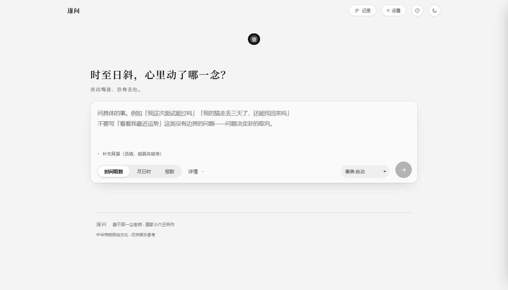
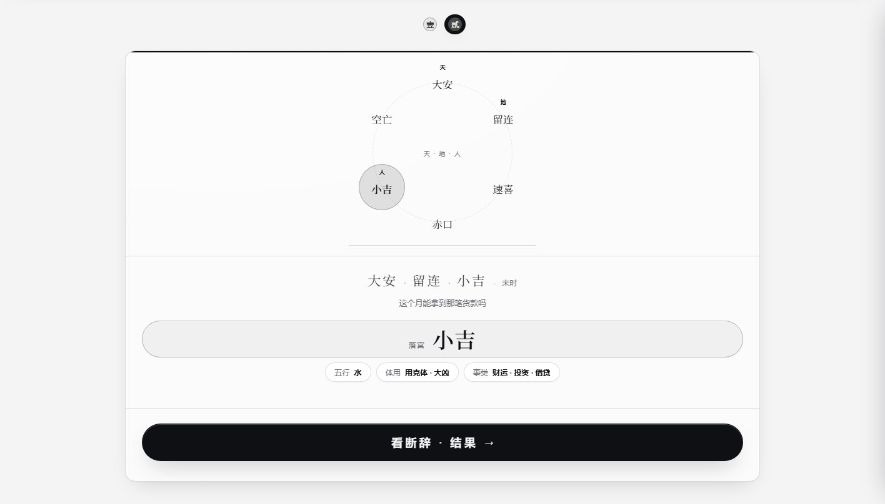
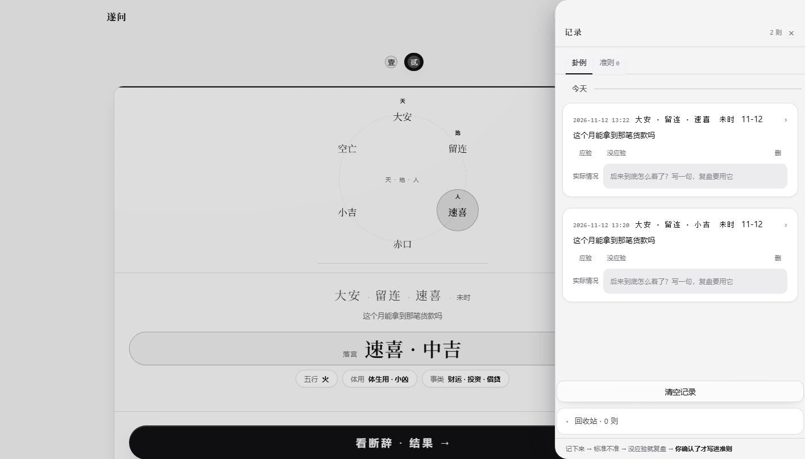
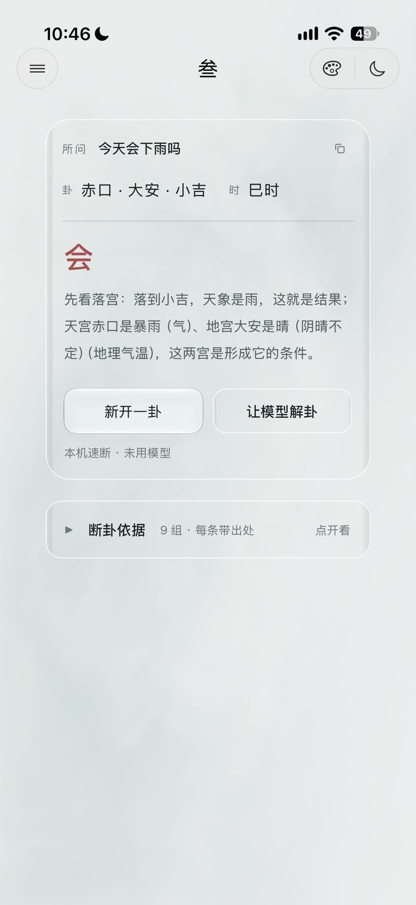
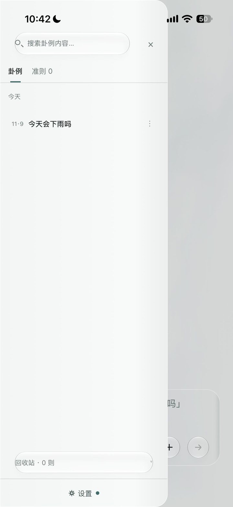
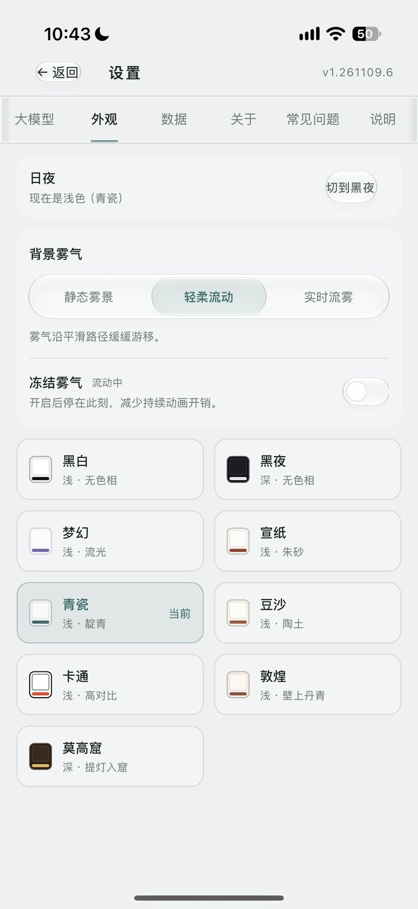
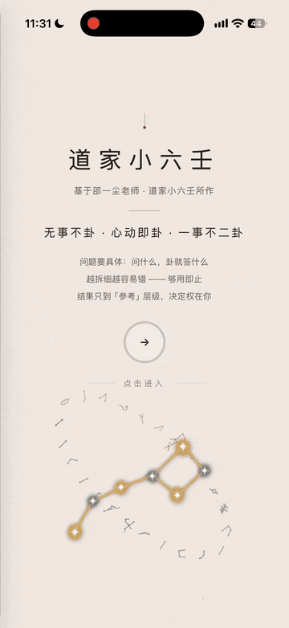

# 遂问

一个在自己电脑和手机上用的小六壬工具。按时间、或者报几个数，把三宫排出来，给出六宫断辞、体用、应期和事类速断。

**起卦、排盘、断卦依据全在本机算**，不联网也能用；接不接大模型由你决定，不接就是纯本机速断。
判据是明文（`apps/shared-judgment/`），想怎么改就怎么改 —— 见 [`README-判据.md`](README-判据.md)。

---

## 目录

- [能做什么](#能做什么)
- [界面](#界面)
- [有哪几个端](#有哪几个端)
- [技术栈](#技术栈)
- [跑起来](#跑起来)
- [判据在哪、怎么改](#判据在哪怎么改)
- [这个仓里有什么](#这个仓里有什么)
- [常见问题](#常见问题)
- [内容与免责](#内容与免责)
- [许可](#许可)

## 能做什么

| | |
|---|---|
| **起卦** | 时间取数、月日时三宫、报数（0 按 10 计）、单宫取象、多选一；起卦前可填所问之事 |
| **排盘** | 六神掌诀走位、天宫 / 地宫 / 人宫（落宫）定位、太极点转换 |
| **断卦** | 宫义、生克、三易、体用（体＝落宫，用＝起卦时辰）、应期取数，每条判据带出处 |
| **事类速断** | 婚姻、孕产、财运、工作、疾病、失物、行人、天气、官司、考试…本机直接出 |
| **卦例本** | 起过的卦自动存档，事后填应验、写复盘、进回收站；可导出 / 导入带走 |
| **接着问** | 卦解完还能追问、补写实际情况，全在同一张卦里 |
| **接模型** | 任何 OpenAI / Anthropic 兼容接口：OpenAI、DeepSeek、智谱、月之暗面、硅基流动、火山方舟、通义、MiniMax、Gemini，或本机 Ollama；预设一键切换 |
| **MCP** | 判据能当工具挂给小智一类客户端：起卦、查典、解卦，由本机算完再回话 |
| **皮肤** | 桌面九套：黑白、黑夜、梦幻、宣纸、青瓷、豆沙、敦煌、莫高窟、铜古；安卓八套（无铜古） |
| **更新** | 装的是桌面版时，设置页可检查更新（清单地址留空就不联网） |

## 界面

桌面（Windows / macOS）：

| 问卦 | 排盘 | 卦例本 |
|---|---|---|
|  |  |  |

手机（安卓与 iOS 是同一套界面，下面这组是 iOS 实机）：

| 断卦 | 卦例本 | 外观 / 皮肤 |
|---|---|---|
|  |  |  |

开屏（手机端录屏，四秒多）：<br>


> 图都是真机 / 真窗口截的，没有修图。皮肤、雾气的浓淡以你自己装上去看到的为准。


## 有哪几个端

| 端 | 在哪 | 怎么出包 |
|---|---|---|
| **桌面（Windows / macOS）** | `apps/desktop-web/` + `apps/desktop-shell/`（Tauri 2 壳） | `npx --yes @tauri-apps/cli@^2 build`；macOS 用 `bash mac/build-desktop.sh` |
| **安卓** | `apps/android/`（Kotlin Multiplatform + Kuikly + Compose） | `gradlew :androidApp:assembleRelease` |
| **iOS** | `apps/android/kuikly/iosApp/` + `.github/workflows/ios-sim.yml` | 推到 GitHub 由 macOS runner 编，出未签名 ipa |

桌面和安卓**不是同一套界面代码**：布局、动画、交互各写各的，判据两边各一份（语义一致）。
iOS 与安卓共用同一份 Kotlin（`shared/`），壳是 Swift。

## 技术栈

| 层 | 用什么 |
|---|---|
| 桌面前端 | React 19、Vite 6、Tailwind 4、GSAP / Motion |
| 桌面外壳 | Tauri 2（Rust），Windows 走 WebView2，macOS 走 WKWebView |
| 判据 | 纯 ES 模块（`apps/shared-judgment`），界面层 import，不含框架依赖 |
| 安卓 / iOS | Kotlin Multiplatform + Kuikly + Compose（`apps/android`） |
| 产物 | 前端用 `vite-plugin-singlefile` 打成单文件 HTML，再由 `protect.py` 上壳 |

## 跑起来

### 只想编译桌面成品

需要 **Node 18+** 和 **Rust（cargo）**；Windows 另需 MSVC Build Tools。

```bash
npm install                      # 仓库根目录，一次

cd apps/desktop-shell
npx --yes @tauri-apps/cli@^2 build
```

产物：`apps/desktop-shell/src-tauri/target/release/xiaoliuren.exe`（单文件，双击即用）。
macOS 用 `bash mac/build-desktop.sh`，细节见 [`mac/README-MAC.md`](mac/README-MAC.md)。

> 双击没反应，八成是系统缺 WebView2 运行时（Win11 自带，Win10 到微软官网装一次即可）。

### 想改前端

```bash
npm install
cd apps/desktop-web
npm run dev                       # 浏览器里调界面，热更新
```

改完怎么重新打进壳、怎么出 exe：[`BUILD.md`](BUILD.md)。

### 想编安卓

需要 JDK 17 与 Android SDK 34（`ANDROID_HOME` 指好即可）：

```bash
cd apps/android/kuikly
./gradlew :androidApp:assembleRelease      # Windows: .\gradlew.bat :androidApp:assembleRelease
# → androidApp/build/outputs/apk/release/androidApp-release.apk
```

仓里不带任何钥匙，没签名配置时自动用调试签名，装得上能跑。签名与目录见 [`apps/android/README.md`](apps/android/README.md)。

### 想编 iOS

Windows 上写代码、GitHub 的 macOS runner 编译，本机不用装 Xcode：

```bash
gh workflow run ios-sim.yml
gh run watch
```

产物在 Actions 的 Artifacts 里（模拟器包 + 未签名 ipa）。细节与坑见
[`apps/android/kuikly/iosApp/README-IOS.md`](apps/android/kuikly/iosApp/README-IOS.md)。

## 判据在哪、怎么改

判据只有一份真源，在 `apps/shared-judgment/`（安卓那份是它的 Kotlin 移植，语义要一致）：

```
corpus/00…08.md          九份体系文档（人读的真源）
      ↓ node tools/gen-corpus.mjs
src/corpus.js            打包成代码读的形式
      ├─ src/judgment.js     六宫固定层 / 通用判据 / 应期 / 事类
      ├─ src/prompt.js       解卦用的系统提示词
      ├─ src/asks.js         本机速断的按问法素材
      └─ src/mcp-tools.js    MCP 工具表与执行（判据从这里取，不另存一份）
```

改 `corpus/*.md` → 跑一次 `node tools/gen-corpus.mjs` → 重新编前端。没有别的地方要同步。
语料里每一处引文都带材料名与出处锚，判据来源与分级见 [`README-判据.md`](README-判据.md)。

## 这个仓里有什么

| 目录 | 内容 |
|---|---|
| `apps/desktop-web/` | 桌面前端：`src/` 界面、`skins/` 皮肤、`styles/` 样式、`legacy/` 历史模块 |
| `apps/shared-judgment/` | 起卦 / 排盘 / 六宫 / 断辞 / 提示词 / 九份语料 / MCP 内核 |
| `apps/android/` | 安卓与 iOS：`kuikly/` 是 Gradle 工程（`shared/` 共享层、`androidApp/`、`iosApp/`） |
| `apps/desktop-shell/` | Tauri 2 壳；`web/index.html` 是入库的加密壳，`pkg/` 是 Windows 启动器 |
| `apps/desktop-web/build/` | 上壳链：`protect.py`（加密）、`prep_tauri_web.py`（生成壳） |
| `tools/` | 组装器、文档入口生成、语料打包 |
| `mac/` | macOS 构建脚本与说明 |
| `docs/images/` | README 里这几张截图 |

## 常见问题

**「Windows 已保护你的电脑」怎么办？**
点「更多信息 → 仍要运行」。没买代码签名证书的个人软件都这样。

**能把 exe 单独拷走吗？**
可以，单文件就是全部。但壳里的前端是加密的，改了源码要重新编才会生效。

**数据存在哪？换电脑能带走吗？**
存在应用自己的本地存储里。设置页有导出 / 导入，换机器拷一份就行；更新版本不会清掉卦例。

**不填 Key 能用吗？**
能。起卦、排盘、本机速断都不需要联网，模型只是把断辞说顺。

**手机上能用吗？**
能，安卓端就在 `apps/android/`（另一套原生实现，编译见那里的 README）；iPhone 走 iOS 那条 CI 管线。

**「检查更新」说不用更新？**
本包没有内置更新清单地址。要用就把 `apps/desktop-web/src/data/updateCore.js`
里的 `ONLINE_MANIFEST` 换成你自己的清单，再重新打进壳里。

更多问题（Key 报错、拉模型列表、解到一半停住、接着问…）在应用内 **设置 → 关于 → 常见问题** 里。

## 内容与免责

- 判据体系出自邵一尘先生所传的「道家小六壬」（卜法卷），应用内与语料中保留讲者署名与分级。
- 属中华传统民俗文化内容，**仅供学习与参考，不作预测、承诺或任何专业意见**，重大决定请自己做。

## 许可

[Apache License 2.0](LICENSE)：可自由使用、修改、分发、商用，保留版权声明与许可副本即可，不提供担保。
